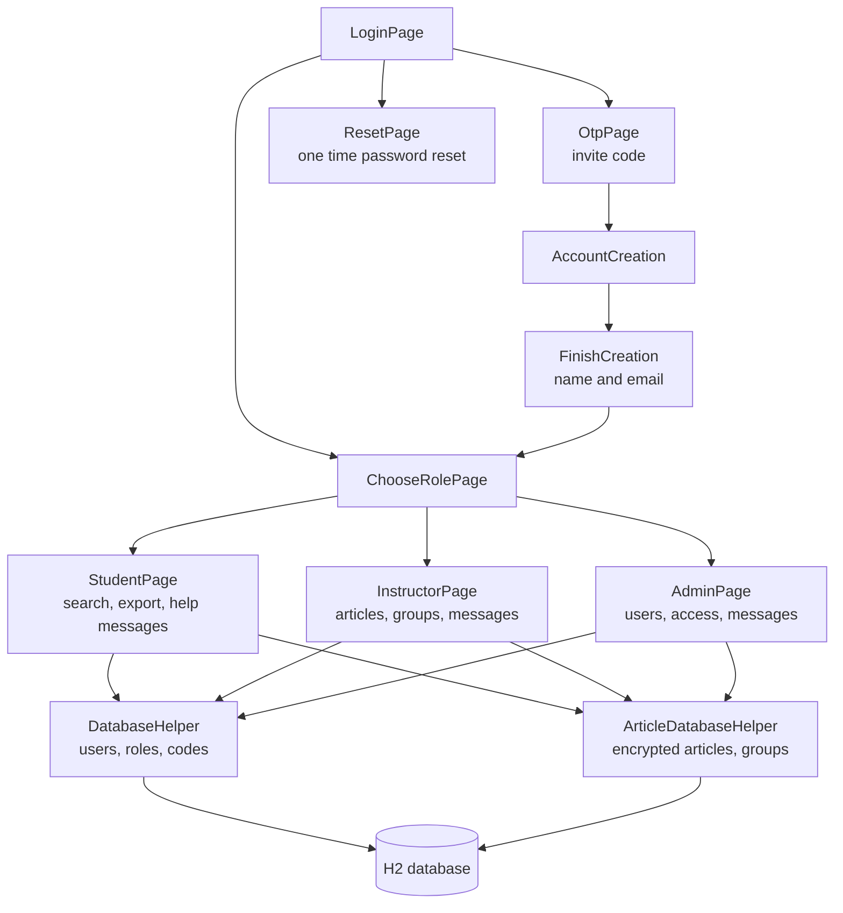

# Support360

A desktop help system for a course, built in Java and JavaFX. Students search a library of help articles and message instructors when they're stuck. Instructors write and organize the articles, and admins manage users and control who can see which groups of articles.

Team project for **CSE 360 (Introduction to Software Engineering)** at Arizona State University, Fall 2024, built in three phases.

## The Problem

Students in a large course ask the same questions over and over, and the answers end up scattered across emails, discussion boards and office hours. Support360 puts the answers in one searchable place, sorted by level and topic. Some articles, like grading notes, need to stay restricted to specific people, so the system also controls access.

## Features

**For students**
- Search articles by keyword and level (beginner to expert)
- Export an article to PDF
- Send a help message: "I'm confused" for general help, or "Can't find info" for something missing, which also tells instructors what to write next
- Read replies in a message inbox

**For instructors**
- Add, update, delete and display articles
- Organize articles into groups
- Back up articles to a file and import them again
- Read and answer student messages

**For admins**
- Invite users with a one time code (OTP) and assign roles
- Delete users
- Manage access to regular and special access article groups

**Accounts and security**
- Invite only sign up: a new user needs a one time code from an admin
- One person can have several roles (student, instructor, admin) and picks one after logging in
- Password reset with a one time code
- Passwords are stored as SHA-256 hashes, never as plain text
- Articles are stored encrypted (AES) in the database

## Tech Stack

| Layer | Technology |
|---|---|
| Language | Java 21 |
| User interface | JavaFX 21 |
| Database | H2 (embedded, file based) |
| PDF export | Apache PDFBox |
| Testing | JUnit 4 |
| IDE | Eclipse |

## Architecture

## Key Decisions

- **Invite only accounts.** Only an admin can create a one time code, so random people can't sign up.
- **Roles are separate from accounts.** One login can hold several roles, and the user chooses which one to act as. A TA can be both a student and an instructor without two accounts.
- **Special access groups.** Some articles are visible only to the people an admin adds to that group, so restricted material stays restricted.
- **Two kinds of help messages.** "I'm confused" and "Can't find info" are separate, so instructors can tell a confusing article apart from a missing one.
- **Two database helpers.** User data and article data live behind separate classes, so changes to articles don't touch login code.

## Run It Locally

You need Java 21, JavaFX 21, Eclipse (with e(fx)clipse), and these jars: H2, Apache PDFBox 2.0, FontBox 2.0 and Commons Logging.

1. Clone the repo and import `Support360` into Eclipse as an existing project.
2. Open **Build Path**, then **Libraries**, and point the H2, PDFBox, FontBox and Commons Logging entries at the jars on your computer.
3. Add your JavaFX 21 library as a user library named `JavaFX21`.
4. Run `LoginPage.java` as a Java application. The H2 database files are created in `Support360/database/` the first time it runs.

Run the tests with `Support360SystemTests.java` (JUnit 4).

## Team

| Person | Work |
|---|---|
| Theren White | Database, password hashing, Phase 2 and Phase 3 features, final integration |
| Maddox | Login, OTP invite system, password reset, admin commands, automated tests, documentation |
| Anshu | Initial project setup, Javadoc and code documentation |
| Manaswi Makkena | Team lead and repository setup; design, testing and documentation |
